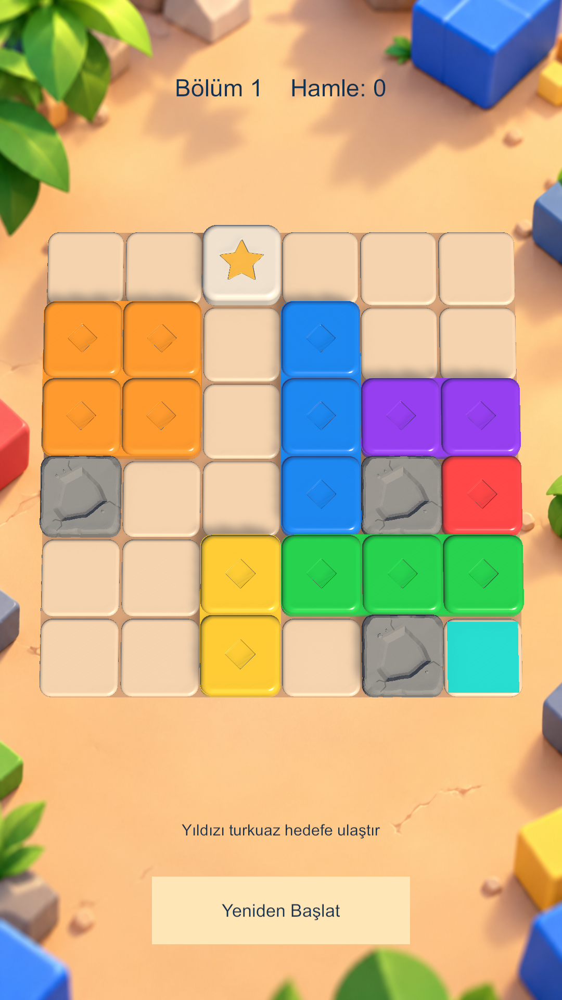

# Block Rift — Movement Rules V2 ve Küçük Aktarma

**2026-10-28: uygulandı ve doğrulandı.** Kullanıcının onayladığı koordinatlar değiştirilmeden Küçük Aktarma mevcut Gameplay sahnesine bağlandı. GDD/skill, kamera/arka plan/board geometrisi ve Blender kaynakları değiştirilmedi. Commit/push yapılmadı.

## Core, Input ve sürüm değişiklikleri

GDD §3.3–4 (sekiz şekil/manuel yönler), §5 (gravity ayrımı), §10 (offline exact proof), §13.1 (başlangıç kararlılığı) esas alındı. Architecture/gameplay/level-generator/level-design ve Unity C#/Input skill'leri uygulandı. Mimari skill'deki eski dokuz şekil/orthographic önerileri yerine güncel GDD ve kullanıcı perspective kararı korundu. İstenen CODEBASE_CLEANUP_AUDIT.md diskte bulunmadı; M1–M7 bulguları önceki kayıtlardan mevcut kodda yeniden kontrol edildi.

| Parça | Manuel izin |
|---|---|
| 1×1, 2×2, yıldız | Dört yön |
| 2×1, 3×1, 4×1 | Yalnız yatay |
| 1×2, 1×3, 1×4 | Yalnız dikey |
| 3×3 | Geçersiz |

- **M1:** PieceDefinition.cs / ShapeCatalog sekiz şekle indirildi; BoardValidator InvalidShape hatası korundu.
- **M2:** MovementEngine.AllowsManualAxis tek manuel izin kaynağıdır. Apply yasak eksende aynı snapshot, Changed=false, ActualDistance=0 döndürür; GameSession hamle saymaz. Solver mevcut Apply/EnumerateLegalMoves üzerinden çalışır, yasak komut üretmez. İkinci hareket/çarpışma motoru yok.
- **M3:** LevelOneGameplay, ekseni kilitlemeden aynı Core izin API'sini sorar. Yasak ilk yön görseli taşımaz/ekseni kilitlemez; asıl geçiş yine Session.Preview/Apply'dır. Mouse/touch korunur.
- **M4:** LevelOne onaylı yerleşimle değiştirildi. Eski bağımsız BFS sonucu yerine yeni production Core Solver/replay kanıtı kullanıldı.
- **M5:** Eski dokuz şekil/dört yönlü uzun blok ve eski gate/blue yerleşimi beklentileri güncellendi. Hiçbir mevcut test dosyası silinmedi.
- **M6:** Mevcut prefab kataloğu genişletildi; dikey yönelimler ve capture mesh sayımı yeni yerleşime uyarlandı.
- **M7:** MovementEngine.RulesVersion **2**; SchemaVersion **1** kaldı. Validator UnsupportedRulesVersion hatasıyla diğer sürümleri reddeder. CreateInitial eski/bilinmeyen içeriği yüklemez; Apply, legal enumeration ve Solve sürüm guard'ı içerir. SolutionProof RulesVersion taşır. RefreshPuzzle proof sürümünü ve tam Core replay'i kontrol etmeden sahne/asset yazmaz.

Manuel yön/renk/prefab mantıkları Core dışında yeniden yazılmadı. Ara hücre çarpışması, sınırlar, sabit engel, NO_OP, mesafeden bağımsız bir hamle, deterministik BFS, INCOMPLETE ve hedefte release öncesi Win korundu. V1 içerik/proof otomatik dönüştürülmedi; eski Editor adayları ve diğer onaylı bölümler değiştirilmedi. Eski aday analizi yeni motorda açık sürüm reddi verir.

Gravity henüz uygulanmamıştı; bu görevde de geliştirilmedi. Trigger'lı level açık NotSupportedException ile reddedilir. Manuel izin API'si otomatik gravity değildir; gelecekte yatay blokların aşağı düşmesi bu filtreden geçirilmemeli. Bu teslim gerçek gravity düşüşünü uyguladı/test etti iddiası içermez.

## Kesin yerleşim ve görsel eşleme

Sol alt (0,0); +X sağa, +Y yukarı/Unity +Z; grid pitch **1 Unity birimi**. BoardRoot/PiecesRoot nötr dönüş/birim ölçek yapısı korundu.

| ID | Şekil | Sol alt hücre | Prefab | Mevcut materyal |
|---|---|---|---|---|
| star | 1×1 | (2,5) | Special_1x1_Star | Ivory/Gold alt materyalleri |
| A | 1×3 | (3,2) | Block_1x3 | BR_Plastic_Blue |
| B | 3×1 | (3,1) | Block_3x1 | BR_Plastic_Green |
| C | 1×2 | (2,0) | Block_1x2 | BR_Plastic_Yellow |
| D | 1×1 | (5,2) | Block_1x1 | BR_Plastic_Red |
| E | 2×1 | (4,3) | Block_2x1 | BR_Plastic_Purple |
| F | 2×2 | (0,3) | Block_2x2 | BR_Plastic_Orange |

Taşlar **(0,2), (4,2), (4,0)**; mevcut Obstacle_1x1_Stone ve texture/materyalleri. Tetikleyici yok. Turkuaz Exit_Cell **(5,0)**, mevcut .004 Y ofsetiyle MarkersRoot/ExitVisual altında; editörde ve Play Mode'da tek örnek.

Bağımsız dikey prefablar yoktu. Aynı onaylı Block_2x1/3x1/4x1 FBX mesh'leri, yeni Block_1x2/1x3/1x4 prefablarında sabit **model çocuğu Y=90°** yönelimiyle kullanıldı. Wrapper dönüşü sıfır; bütün ölçekler bir. Yeni mesh/FBX, geçici model veya ölçek hilesi yok; oyuncu rotasyonu eklenmedi. Üç Unity testi gerçek mesh paylaşımı, bütün alt ölçekler ve vertex bounds/pivot doğruladı. Katalog **11 entry**: sekiz yönelim + yıldız + taş + 6×6 board. Gerçek 5×5 board asseti üretilmedi; mantıksal 5×5 grid/kamera desteği test edildi.

## Production Core Solver sonucu

**BoardValidator geçerli — Solved — rulesVersion 2 — minimum 8 — visited 8.972 — tam replay WIN.** BFS tamamlanmış minimumu verdi; daha kısa yol bu aramada yok. Her adımın izinli ekseni/ActualDistance değeri kontrol edildi.

| Hamle | Hareket | Başlangıç → bitiş |
|---:|---|---|
| 1 | star sağ 3 | (2,5) → (5,5) |
| 2 | C yukarı 2 | (2,0) → (2,2) |
| 3 | B sol 3 | (3,1) → (0,1) |
| 4 | A aşağı 2 | (3,2) → (3,0) |
| 5 | D aşağı 1 | (5,2) → (5,1) |
| 6 | D sol 1 | (5,1) → (4,1) |
| 7 | E sol 1 | (4,3) → (3,3) |
| 8 | star aşağı 5 | (5,5) → (5,0), anında Win |

Seçilen yolda 5 farklı engel hareket eder; D iki eksende park edilir, F hareket etmez. C→B→A→E alan açma zinciri, B→D park imkânı vardır; D/E sağ iniş koridorunu temizler. B veya C başlangıçta dondurulduğunda kazanma olmadığını tam kalite taramaları doğruladı. Diğer her engelin bütün çözümlerde hareket etmesi gerektiği iddia edilmiyor. Zorluk etiketi kullanıcı onayındaki Kolay'dır; yalnız hamle sayısından zorluk puanı türetilmedi.

## TDD / gerçek test sonuçları

Kanıt kökü: `C:/Users/sahba/BlockRift/TestResults/MovementV2_20261028_131845/`.

| Çalışma | Gerçek sonuç | Kayıt |
|---|---|---|
| V2 testleri / eski Core — RED | 107 geçti, **18 başarısız** | core-red.xml |
| İlk Core migration | 121 geçti, 4 eski yerleşim beklentisi başarısız | core-migration.xml |
| Son saf Core/Application | **135 geçti, 0 başarısız, 0 atlandı** | core-final.xml |
| İlk Unity EditMode | 213 geçti, 1 eski mesh sayımı başarısız | editmode.xml |
| Son Unity EditMode | **214 geçti, 0 başarısız, 0 atlandı** | editmode-final.xml |
| Unity PlayMode | **8 geçti, 0 başarısız, 0 atlandı** | playmode.xml |

135 saf test 214 EditMode testinin alt kümesidir; ayrıca toplamla toplanmamalı. Mesh sayımı beklentisine editörde görünür hedef eklendi ve hedef dünya koordinatı da test edildi. Başarısız çalışmalar saklandı, test gizlenmedi.

Kapsam: sekiz şeklin 32 yön kombinasyonu, hedefin dört yönü, 3×3/invalid shape, eski/bilinmeyen sürüm retleri, aynı snapshot/NO_OP, hamle sayımı, ara hücre/sınır, açık trigger desteği reddi, kesin A–F koordinatları, minimum/replay/INCOMPLETE; gerçek prefab/materyal, 5×5/6×6 kadraj, mouse/touch, yasak görsel hareket/state, kare iki eksen, Restart ve release öncesi Win.

### Gerçek komutlar ve ortam

Unity **6000.3.23f1**, URP **17.3.0**. Açık ana editöre müdahale etmemek için cache'li ignored doğrulama projesi kullanıldı:
`C:/Users/sahba/BlockRift/TestResults/SafeCleanupPhase1_20261027_234230/ValidationProject`.

Ana Assets/Packages/ProjectSettings snapshot'ı kopyalandı; eski temizliğe özel iki yardımcı test bu kopyadan çıkarıldı. Yeni sayılara bu eski yardımcılar dahil değil. Ana/test C# kaynakları ve teslim edilen dokuz sahne/asset dosyası byte olarak karşılaştırıldı. İzole importun normalize ettiği Mobile_RPAsset ana projeye aktarılmadı.

```powershell
& TestResults/MovementV2_20261028_131845/run-core.ps1
```

Bu script kaynakları mevcut NUnit ile bellekte derleyip gerçekten çalıştırır; başka bir hareket motoru değildir. İlk red/ara çalışmalar da aynı Add-Type/NUnit runner yöntemiyle koşuldu.

Unity aşağıdaki argümanlarla gerçekten çalıştırıldı; yer tutucular yerine tam mutlak proje/log/XML yolları kullanıldı:

```text
Unity.exe -batchmode -nographics -projectPath <izole-proje>
  -executeMethod BlockRift.Editor.LevelOneSetup.RefreshPuzzle -quit -logFile <integrate.log>
Unity.exe -batchmode -nographics -projectPath <izole-proje>
  -runTests -testPlatform EditMode -testResults <editmode-final.xml> -logFile <editmode-final.log>
Unity.exe -batchmode -nographics -projectPath <izole-proje>
  -runTests -testPlatform PlayMode -testResults <playmode.xml> -logFile <playmode.log>
Unity.exe -batchmode -force-d3d11 -projectPath <izole-proje>
  -executeMethod BlockRift.Editor.GameplayGameViewCapture.CaptureBatch -logFile <gameview.log>
```

Core doğrulaması ve Unity testleri tamamlanmadan sahne ana projeye aktarılmadı. Eski temizliğin XML'leri bu teslimin testi gibi kullanılmadı. Sınırlı C#/test yollarında `git diff --check` geçti; yalnız CRLF→LF uyarıları vardı.

## Gerçek Game View / koruma



Unity Play Mode / ScreenCapture çıktısıdır; mockup veya AI görseli değildir. PNG **1080×1920** boyutu dosyadan doğrulandı; görsel A–F/yıldız/taş/hedef koordinatlarıyla karşılaştırıldı. SHA256: `86e20fa762c88abd80350e366604bd1d4bc755d0b3b38ca5fd0bdc3dc27d9d1d`.

Mevcut ortak sahne YAML belgelerinden yalnız PiecesRoot/MarkersRoot çocuk listeleri değişti; kamera, background, board ve UI belgeleri aynı. Eski instance'lar onaylı yenileriyle değiştirildi. Blender/FBX, eski materyal/dokular, GDD/CONSISTENCY dahil **43 korunan dosya** başlangıç hash'leriyle aynı. BoardGridLayout/BoardVisualLayout ve kamera/viewport kodları değiştirilmedi.

Önceki [V1 rapor](archive/development/LEVEL1_RULES_V1_REPORT.md), [V1 spec](archive/development/LEVEL1_RULES_V1_SPEC.md) ve [V1 görsel](archive/screenshots/Level1_RulesV1_GameView.png) korundu.

## Kalan sınırlar ve riskler

- Gravity/cascade, Undo/Hint, ekonomi/save ve Generator geliştirilmedi. Otomatik gravity manuel yön filtresinden bağımsız olmalı; açık NotSupported koruması devam ediyor.
- V1 level/proof'lar yeniden doğrulanmadan v2 sayılmamalı. Eski manuel adaylar değiştirilmedi. Gelecekte level/sürümler arasında cache eklenirse levelId/rulesVersion da cache kimliğine alınmalı.
- PlayMode testlerinde oyun koduna ait beklenmeyen hata yok. Grafik yakalama başlangıcında önceki entegrasyon raporlarında da kayıtlı **UnityEditor.Search.SearchDatabase ArgumentOutOfRangeException** tekrar görüldü. Capture tamamlandı; “Editor Console tamamen hatasız” iddiası yok. Ana Editor cache'ine müdahale edilmedi.
- Yakalama aracının yardımcı JSON'u o anda Screen değerlerini 1918×991 yazdı; bu backbuffer/UI metriği PNG boyutu sayılmadı. Teslim PNG'si dosyadan 1080×1920 doğrulandı; yardımcı JSON çözünürlük kanıtı olarak kullanılmadı.
- Geometri/normal düzeltmesi ve gerçek cihaz performans testi yapılmadı; mevcut shading kalitesi korundu.
- Commit/push/reset/clean yapılmadı.

## Değiştirilen dosyalar

Bu görevin Git çalışma ağacı; ignored TestResults kanıtları ayrıca saklanır.

```text
 M Assets/Scenes/BlockRift_Gameplay.unity
 M Assets/_BlockRift/Content/GameplayVisualCatalog.asset
 M Assets/_BlockRift/Content/LevelOnePalette.asset
 M Assets/_BlockRift/Core/Board/BoardSolver.cs
 M Assets/_BlockRift/Core/Board/BoardValidator.cs
 M Assets/_BlockRift/Core/Board/LevelOne.cs
 M Assets/_BlockRift/Core/Board/MovementEngine.cs
 M Assets/_BlockRift/Core/Board/PieceDefinition.cs
 M Assets/_BlockRift/Editor/GameplayGameViewCapture.cs
 M Assets/_BlockRift/Editor/LevelOneSetup.cs
 M Assets/_BlockRift/Presentation/Board/LevelOneGameplay.cs
 M Assets/_BlockRift/Tests/EditMode/BoardValidatorTests.cs
 M Assets/_BlockRift/Tests/EditMode/LevelOneQualityTests.cs
 M Assets/_BlockRift/Tests/EditMode/LevelOneTests.cs
 M Assets/_BlockRift/Tests/EditMode/MovementTests.cs
 M Assets/_BlockRift/Tests/PlayMode/LevelOnePlayTests.cs
 M Assets/_BlockRift/Tests/Presentation/BoardVisualLayoutTests.cs
 M Assets/_BlockRift/Tests/Presentation/GameplayArtIntegrationTests.cs
 M Assets/_BlockRift/Tests/Presentation/GameplaySceneTests.cs
 M README.md
 M docs/Gameplay_6x6_GameView.png
 M docs/LEVEL1_REPORT.md
 M docs/LEVEL1_SPEC.md
 M docs/README.md
?? Assets/_BlockRift/Art/Prefabs/Gameplay/Block_1x2.prefab
?? Assets/_BlockRift/Art/Prefabs/Gameplay/Block_1x2.prefab.meta
?? Assets/_BlockRift/Art/Prefabs/Gameplay/Block_1x3.prefab
?? Assets/_BlockRift/Art/Prefabs/Gameplay/Block_1x3.prefab.meta
?? Assets/_BlockRift/Art/Prefabs/Gameplay/Block_1x4.prefab
?? Assets/_BlockRift/Art/Prefabs/Gameplay/Block_1x4.prefab.meta
?? Assets/_BlockRift/Tests/EditMode/MovementRulesV2Tests.cs
?? Assets/_BlockRift/Tests/EditMode/MovementRulesV2Tests.cs.meta
?? docs/archive/development/LEVEL1_RULES_V1_REPORT.md
?? docs/archive/development/LEVEL1_RULES_V1_SPEC.md
?? docs/archive/screenshots/Level1_RulesV1_GameView.png
```
